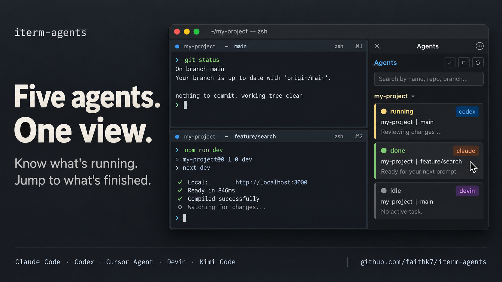
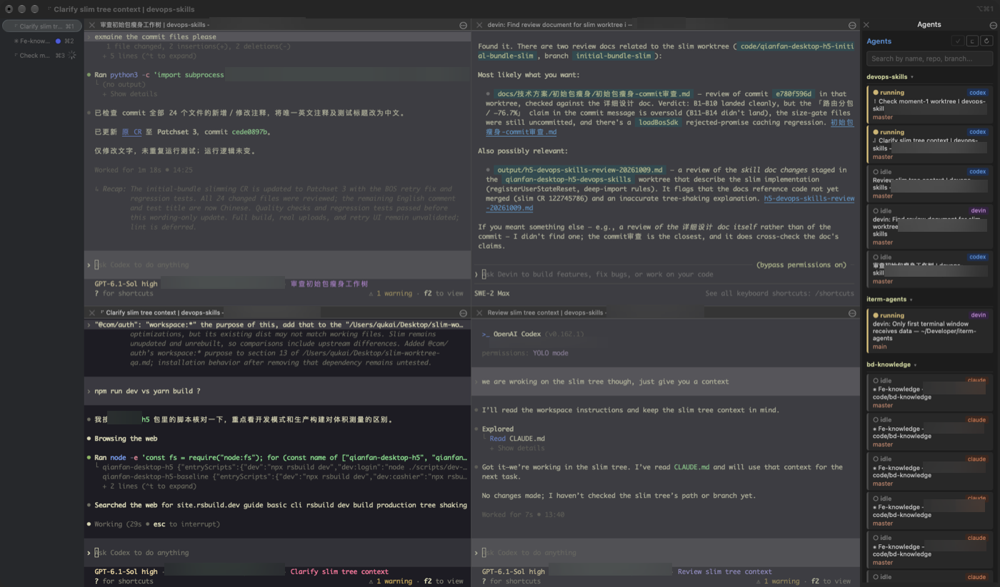

# iterm-agents

[简体中文](README.md) | [English](README.en.md)



An iTerm2 toolbelt panel that watches your terminal sessions and shows which
coding agents are running — Claude Code, Codex, Cursor Agent, Devin, and Kimi
Code — so you can see at a glance which turn is still working and which just
finished, then click through to that pane.



## Supported agents

| Agent        | Detected process                                     |
| ------------ | ---------------------------------------------------- |
| Claude Code  | `claude`                                             |
| Codex        | `codex`                                              |
| Cursor Agent | `cursor-agent` (or `node`/`agent` on its `index.js`) |
| Devin CLI    | `devin`                                              |
| Kimi Code    | `kimi` / `kimi-code`                                 |

## What you get

- **Multiple windows** — an Agents panel in every iTerm2 window.
- **Live status** — `running` (working), `done` (just finished), or `idle`.
- **Repo grouping** — worktrees share their main repo's group; collapse one or all.
- **Click to jump** — focus a session's terminal pane.
- **Search** — find sessions by name, repo, branch, or agent.

Everything stays on your Mac. The monitor reads local processes, git
repositories, and the visible text of your iTerm2 sessions; it serves the panel
only on `127.0.0.1` and sends nothing over the network.

## Requirements

- **macOS with [iTerm2](https://iterm2.com/)**, open while the monitor runs.
- iTerm2's **Python API** and **Shell Integration** enabled
  ([steps below](#set-up-iterm2)).
- **Git** for repo information and manual cloning. If `git --version` fails,
  run `xcode-select --install`, finish Apple's Command Line Tools installation,
  then retry.
- Python ≥ 3.10. The quick installer sets up Python and
  **[uv](https://docs.astral.sh/uv/getting-started/installation/)** for you.
- At least one supported agent CLI, installed and signed in separately.
  iterm-agents monitors your existing CLIs; it does not install or launch them.

## Quick start

Set up iTerm2, run the installer, and reopen iTerm2 to get started.

### Set up iTerm2

Open iTerm2. If you have not installed it yet, download it from
[iterm2.com](https://iterm2.com/) and move it into **Applications**.

1. **Enable the Python API** — press `Cmd+,`, open **General → Magic**, and
   tick **Enable Python API**. Restart iTerm2 if it asks.
2. **Enable Shell Integration** — choose **iTerm2 → Install Shell
   Integration**, follow the prompts, and open a new tab with `Cmd+T`. It
   lets the panel show repo and branch information. See
   [iTerm2's Shell Integration guide](https://iterm2.com/documentation-shell-integration.html).

### Install

Paste this command into an iTerm2 tab:

```bash
curl -fsSL https://raw.githubusercontent.com/faithk7/iterm-agents/main/install.sh | bash
```

The [installer](install.sh) sets up uv, Python, dependencies, and automatic
startup with iTerm2. It installs under
`~/.local/share/iterm-agents` and requires no Homebrew or `sudo`.

### Start using it

1. When installation finishes, press `Cmd+Q` to quit iTerm2, then reopen it.
2. The **Agents** panel should appear on the right. If it is hidden, choose
   **View → Show Toolbelt**.
3. In a terminal, enter your project and run an installed agent such as
   `claude` or `codex`. Its session status appears in the panel; click to jump
   to its pane.

## Installation options

### Manual startup and updates

To start the installed monitor manually:

```bash
"$HOME/.local/share/iterm-agents/venv/bin/iterm-agents"
```

Rerun the installer command to update, then restart the monitor to load the
new version. Keep its installation folder in place for AutoLaunch to work.

If you already have a checkout, you can install your local version with:

```bash
bash install.sh --source .
```

Use `--no-autolaunch` for manual startup only. If an existing wrapper differs,
the installer will stop rather than overwrite it; use `--force-autolaunch`
when you intend to replace it. For example:

```bash
bash install.sh --source . --no-autolaunch
bash install.sh --source . --force-autolaunch
```

Run `bash install.sh --help` for all options, including a custom install folder.

### Manual setup with uv

Finish [Set up iTerm2](#set-up-iterm2) first. Keep the checkout in a location
you plan to keep if you want automatic startup later. Run the terminal commands
below inside iTerm2.

1. **Install uv** if you do not already have it. With Homebrew:

   ```bash
   brew install uv
   ```

   Without Homebrew, follow the
   [uv installation guide](https://docs.astral.sh/uv/getting-started/installation/).

2. **Clone, install, and start the monitor:**

   ```bash
   git clone https://github.com/faithk7/iterm-agents.git
   cd iterm-agents
   uv sync
   uv run iterm-agents
   ```

   Keep this command running in its tab or pane. Press `Ctrl+C` there to stop
   the monitor. To start it again, run `uv run iterm-agents` from the checkout.

The **Agents** panel opens in each window's toolbelt. If it is hidden, use
**View → Show Toolbelt**.

## Check that it works

1. If you started the monitor in a terminal, it should print something like:

   ```text
   iterm-agents: running (http://127.0.0.1:50123/)
   iterm-agents: Ctrl+C to stop
   ```

   The port is chosen automatically and may differ from this example. With
   automatic startup there is no terminal to watch: the **Agents** panel
   appearing is the check, and `pgrep -fl iterm-agents` lists the running
   monitor.

2. Press `Cmd+T` to open another tab, change into a git repository, and launch
   a supported CLI you already use, such as `claude` or `codex`.

3. Find that session in **Agents**. You should see its agent badge and, with
   Shell Integration active, its repo/branch information.

4. Submit a prompt and watch the status change to **running**, then **done**
   when the monitor observes the turn ending. Click its row to focus that pane
   and clear the done mark. Detection depends on the signals described below.

## Automatic startup

The macOS installer sets up AutoLaunch by default. The commands below are for
manual installations; installer users can replace `uv run iterm-agents` with
`"$HOME/.local/share/iterm-agents/venv/bin/iterm-agents"`.

After checking that manual startup works, press `Ctrl+C` in the monitor's
terminal, then install the AutoLaunch wrapper from the checkout:

```bash
uv run iterm-agents --install-autolaunch
```

Then quit and reopen iTerm2. You can now use the panel without keeping a
dedicated monitor tab open.

The wrapper is written to
`~/Library/Application Support/iTerm2/Scripts/AutoLaunch/iterm-agents.py`,
separate from it2ag's autolaunch script. Only one monitor instance runs at a
time; starting another prints `iterm-agents: already running` and exits.

Manual uv installations record the checkout's absolute path; keep the checkout
and `.venv` in place. The installer records the installed executable's absolute
path; keep its installation folder in place. If you move a manual checkout,
recreate its virtual environment at the new location and reinstall the wrapper with:

```bash
uv run iterm-agents --install-autolaunch --force
```

Use `--force` only when you intend to replace the existing wrapper. The same
command updates an older wrapper to use the current installation.

### Disable automatic startup

Remove this project's wrapper:

```bash
rm "$HOME/Library/Application Support/iTerm2/Scripts/AutoLaunch/iterm-agents.py"
```

Removing it prevents future automatic launches; it does not stop an already
running monitor. Quit and reopen iTerm2 after removing it. You can still start
the monitor manually with the command under
[Installation options](#installation-options).

## Uninstall

Remove the AutoLaunch wrapper as shown above, stop the monitor, then delete the
installation:

```bash
pkill -f 'bin/iterm-agents'
rm -rf "$HOME/.local/share/iterm-agents"
```

Use your own folder if you installed with `--install-dir`; for a manual setup,
delete the checkout instead. uv may also keep a downloaded Python and a cache
under `~/.local/share/uv` and `~/.cache/uv`; remove those only if nothing else
uses uv.

## Usage

- **done** means the current turn ended, not that the task succeeded. Clicking
  the session clears its done mark.
- Right-click a session to add a label or mark it read. Labels disappear when
  the session or monitor exits.
- `Cmd+Shift+M` opens the toolbelt in the current window and focuses search.

With the panel focused, use `↑` / `↓` to select a session, `Enter` to jump to
its pane, and `Escape` to close a menu or return to search.

## Troubleshooting

| Symptom | What to check |
| --- | --- |
| Panel missing or failing to load | Press `Cmd+Shift+M`; if it still fails, check the [Python API settings](#set-up-iterm2) and try [manual startup](#manual-startup-and-updates). |
| Repo or branch missing | Enable Shell Integration, open a new tab, and enter a git repository. |
| Agent not detected | Run a supported CLI in a local iTerm2 pane. Remote agents over SSH and desktop apps are not supported. |
| Incorrect status | Detection uses processes and English screen hints, which can change between CLI versions. See [How detection works](#how-detection-works). |
| `already running` | The monitor is already active; use its existing panel. |
| Automatic startup fails | Check that the installation folder still exists, try manual startup, then reinstall the wrapper using [Automatic startup](#automatic-startup). |

To inspect the available commands or report your version:

```bash
uv run iterm-agents --help
uv run iterm-agents --version
```

The local server selects an available port by default. If you need a fixed
port, use `uv run iterm-agents --port 50123`; choose an unused port.

## How detection works

Local CLI processes identify agent sessions. Child processes, system activity
signals, and terminal screen hints indicate whether a turn is running. A
transition from running to idle produces a **done** mark.

Screen hints currently match English text only and may change between CLI
versions. Remote agents over SSH and desktop apps are not supported. See
[process detection](src/iterm_agents/detector.py) and
[screen signals](src/iterm_agents/screen_signals.py) for implementation details.

## Development

```bash
uv run pytest            # tests
uv run ruff check src/   # lint
uv run mypy src/         # typecheck (src/ only; tests use fakes)
```

`uv sync` installs the project editable, so code in `src/` is picked up after
restarting the monitor.

See [Python architecture](docs/architecture.md) for module responsibilities,
the observation-to-display flow, and cache/focus state rules.

## Acknowledgements

[it2ag](https://github.com/mkusaka/it2ag) by
[@mkusaka](https://github.com/mkusaka) — the project this is derived from.
Its process scan, toolbelt panel, session list, git and worktree grouping,
click-to-focus, and the Claude Code and Codex activity signals are reused
here; the Cursor Agent, Devin, and Kimi Code detection is new. See
[NOTICE](NOTICE).

## License

GPL-2.0. See [LICENSE](LICENSE) and [NOTICE](NOTICE).
