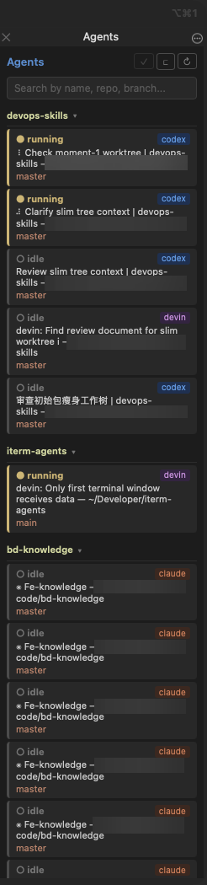

# iterm-agents

An iTerm2 toolbelt panel that watches your terminal sessions and shows which
coding agents are running — Claude Code, Codex, Cursor Agent, Devin, and Kimi
Code — so you can see at a glance which turn is still working and which just
finished, then click through to that pane.



Derived from [it2ag](https://github.com/mkusaka/it2ag) by mkusaka (GPL-2.0).
The panel, session list, git grouping, click-to-focus, and the Claude Code and
Codex activity signals come from that project. See [NOTICE](NOTICE).

## Supported agents

| Agent | Detected process |
| --- | --- |
| Claude Code | `claude` |
| Codex | `codex` |
| Cursor Agent | `cursor-agent` (or `node`/`agent` on its `index.js`) |
| Devin CLI | `devin` |
| Kimi Code | `kimi` / `kimi-code` |

## What you get

- **An Agents panel in every window** — opened in each existing window at
  launch and in every window you open afterwards; a toolbelt you hide by hand
  stays hidden.
- **Live state per session** — `running` while a turn is live, `done` when one
  just finished, `idle` otherwise.
- **Repo grouping** — sessions group under their git repo, with worktrees
  folding into the main repo; groups collapse individually or all at once.
- **Jump to a session** — click a row to focus that pane; `Cmd+Shift+M`
  focuses the panel's search box from anywhere in iTerm2.
- **Search** — filter sessions by name, repo, branch, or agent type.

## Requirements

- iTerm2 with the Python API enabled (setup below).
- iTerm2 **Shell Integration** installed in your shell.
- Python ≥ 3.10. The commands below use [uv](https://docs.astral.sh/uv/);
  a plain venv + pip works too.

## Set up iTerm2

1. **Enable the Python API** — iTerm2 → **Settings → General → Magic** →
   tick **Enable Python API**. Restart iTerm2 if it asks.
2. **Install Shell Integration** — **iTerm2 menu → Install Shell
   Integration**, then restart your shell (or open a new tab). It reports
   each session's working directory, which powers the repo/branch labels
   and lets a row click land on the right pane.
3. **Start the monitor** — `uv run iterm-agents` (see below), or install
   the AutoLaunch wrapper so it starts with iTerm2.
4. The **Agents** panel opens in every window's toolbelt automatically.
   If you close it, **View → Show Toolbelt** reopens it for that window;
   `Cmd+Shift+M` shows it and focuses the search box.


## Install

```bash
git clone https://github.com/faithk7/iterm-agents.git
cd iterm-agents
uv sync    # or: python3 -m venv .venv && .venv/bin/pip install .
```

## Run

```bash
uv run iterm-agents    # or: .venv/bin/iterm-agents
```

To start it automatically whenever iTerm2 launches (recommended):

```bash
uv run iterm-agents --install-autolaunch    # add --force to overwrite an existing wrapper
```

then restart iTerm2. The wrapper is written to
`~/Library/Application Support/iTerm2/Scripts/AutoLaunch/iterm-agents.py`,
separate from it2ag's autolaunch script.

## Usage

- Each row shows a color-coded agent badge and a status: **running**, **done**,
  or **idle**. A row with no detected agent shows its session name only.
- Click a row to jump to that terminal pane; a done row's mark clears on click.
- New panels display the existing session list while it refreshes in the
  background, so opening another window does not wait for a full scan.
- Each window's panel highlights only that window's active pane. A panel
  connects its focus marker the first time its window is the active iTerm2
  window; clicking inside the panel also connects it. The same WebView
  remembers its connection across page reloads. Terminal-pane clicks then
  update the marker automatically.
  Switching windows keeps the other panels' markers and scroll positions.
- Right-click a card for its menu: label it, focus it, or mark it read.
  Labels show as a chip in the card's top row and last until the session or
  the monitor exits.
- Header buttons: `✓` marks every done session as read, `⊏` collapses or
  expands all repo groups, `↻` refreshes.
- `Cmd+Shift+M` opens the toolbelt in the current window and focuses search.

## How detection works

| Agent | Process | Running |
| --- | --- | --- |
| Claude Code | executable name `claude` | a `caffeinate` child, the signal it2ag uses |
| Codex | executable name `codex` | a sandbox child, the IOKit assertion `Codex is running an active turn`, or the `(… esc to interrupt)` hint above its composer |
| Cursor Agent | `cursor-agent`, or `node` / `agent` whose command line contains both `/cursor-agent/` and `index.js` | a busy child, or a composer footer that says `ctrl+c to stop` and is still changing |
| Devin CLI | executable name `devin` | a busy child, or the `(esc … to interrupt)` hint above its input box |
| Kimi Code | executable name `kimi` or `kimi-code` | a busy child, or an in-progress status label above its composer |

Not treated as CLIs: the Cursor editor (`Cursor.app`), the Kimi desktop app,
and `kimi-cu`. Cursor Agent runs as a private `node` binary, so its command
line must point at `index.js` under `/cursor-agent/`; a bare `agent` process
with no such path is ignored.

Cursor Agent, Devin, and Kimi Code publish no turn signal like Claude's or
Codex's, so with no busy child they fall back to the session's screen. Each
hint must appear above the live composer, so transcript echoes don't match.
All hints are English UI text; a localized build may not be detected.

- **Cursor** — `ctrl+c to stop` in the composer while the screen keeps
  changing; the spinner alone keeps a quiet stall alive. A footer frozen for
  30 seconds counts as finished.
- **Devin** — `esc twice/again to interrupt` above the input box.
- **Codex** — `esc to interrupt` above the `›` composer or `? for shortcuts`
  footer; covers sandbox-disabled launches where no child or assertion appears.
  After a running turn, fresh idle observations must span three seconds before
  the panel shows **done**. Brief pauses keep showing **running**; failed reads
  preserve the last state and reset this confirmation period. Completion
  normally appears about three to four seconds later with one-second polling.
- **Kimi** — a `Working…`/`Prompting…`/`Orchestrating…`/`Queued…`/
  `Rate limited…`/`Thinking…` status label, or a bare spinner + `· Tip:` line
  while a tool runs. `Completed.`/`Failed.`/`Aborted.`/`Cancelled.` don't
  count.

## Development

```bash
uv run pytest            # tests
uv run ruff check src/   # lint
uv run mypy src/         # typecheck (src/ only; tests use fakes)
```

`uv sync` installs the project editable, so code in `src/` is picked up after
restarting the monitor.

## Acknowledgements

[it2ag](https://github.com/mkusaka/it2ag) by
[@mkusaka](https://github.com/mkusaka) — the project this is derived from.
Its process scan, toolbelt panel, session list, git and worktree grouping,
click-to-focus, and the Claude Code and Codex activity signals are reused
here; the Cursor Agent, Devin, and Kimi Code detection is new. See
[NOTICE](NOTICE).

## License

GPL-2.0. See [LICENSE](LICENSE) and [NOTICE](NOTICE).
