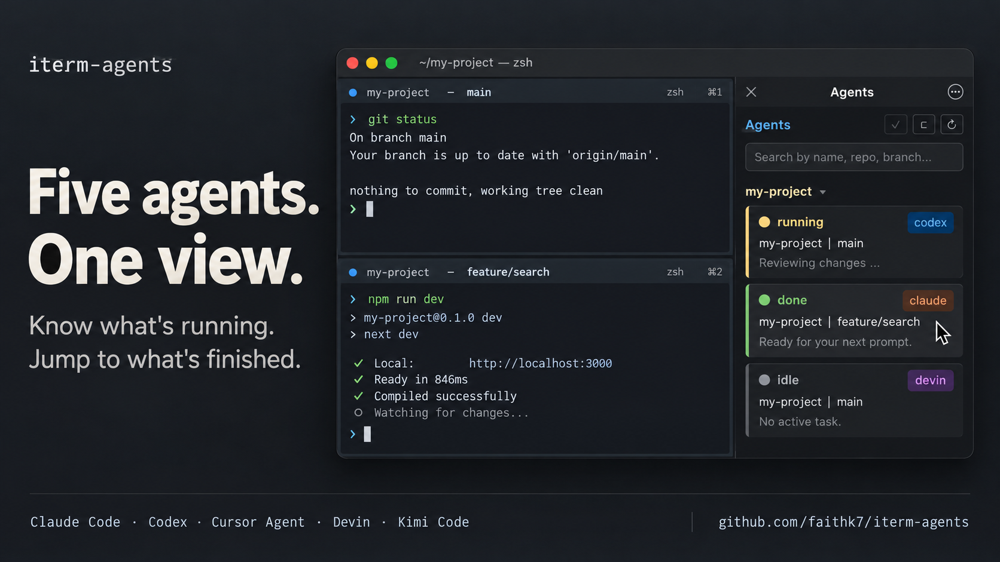
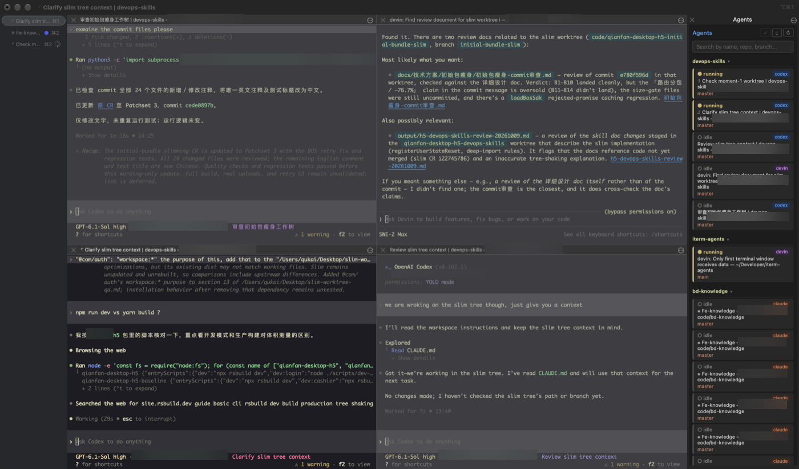

# iterm-agents

[简体中文](README.md) | [English](README.en.md)



在 iTerm2 工具栏（Toolbelt）里一眼看到所有 AI 编程智能体的状态：谁在运行、谁已完成、谁在空闲。点击会话即可跳到对应窗格，接手下一步



支持 Claude Code、Codex、Cursor Agent、Devin CLI、Kimi Code 和 Qoder CN CLI。

- **实时状态**：`running`（处理中）、`done`（本轮刚结束）、`idle`（空闲）
- **一键跳转**：点击会话，聚焦对应终端窗格
- **按仓库分组**：worktree 归入主仓库，还可创建带名称和颜色的自定义分组
- **搜索**：按会话、仓库、分组、分支或智能体查找

所有数据都留在你的 Mac 上：监控程序读取本地进程、Git 仓库和 iTerm2 中可见的终端文本，面板服务只监听 `127.0.0.1`。

## 安装

需要 macOS 和 [iTerm2](https://iterm2.com/)，以及至少一个已安装并登录的智能体 CLI（iterm-agents 只监控，不会安装或启动它们）。

**1. 配置 iTerm2**

- 按 `Cmd+,`，打开 **General → Magic**，勾选 **Enable Python API**
- 选择 **iTerm2 → Install Shell Integration**，完成后按 `Cmd+T` 开一个新标签页（用于显示仓库和分支）

**2. 在 iTerm2 中运行安装命令**

```bash
curl -fsSL https://raw.githubusercontent.com/faithk7/iterm-agents/main/install.sh | bash
```

脚本会自动配置 uv、Python 和依赖，并设置随 iTerm2 自动启动。默认装在 `~/.local/share/iterm-agents`，不需要 Homebrew 或 `sudo`。如果 `git --version` 报错，先运行 `xcode-select --install`。

**3. 重启 iTerm2**

按 `Cmd+Q` 退出后重新打开，右侧会出现 **Agents** 面板（没有的话选择 **View → Show Toolbelt**）。在终端里运行 `claude`、`codex` 等智能体，面板就会显示它们。

## 使用

- **done** 只表示本轮已结束，不代表任务成功。点击会话会清除完成标记
- 右键会话：添加标签、加入分组、标记为已读、上移或下移
- 拖动卡片或分组标题可调整顺序；把卡片拖到分组上即可加入
- 右键分组标题：改名、换颜色、解散分组（保留会话），或在确认后关闭组内所有会话
- 按住 `Cmd`、`Ctrl` 或 `Shift` 点击可多选，`Esc` 取消
- `Cmd+Shift+M` 打开当前窗口的面板并聚焦搜索框；`↑` / `↓` 选择，`Enter` 跳转

## 更新与卸载

**更新**：再次运行安装命令，然后重启 iTerm2。

**卸载**：

```bash
rm "$HOME/Library/Application Support/iTerm2/Scripts/AutoLaunch/iterm-agents.py"
pkill -f 'bin/iterm-agents'
rm -rf "$HOME/.local/share/iterm-agents"
```

只想关闭自动启动时，只删第一行的脚本即可，之后仍可手动运行 `"$HOME/.local/share/iterm-agents/venv/bin/iterm-agents"`。

面板空白或卡住时，运行 `"$HOME/.local/share/iterm-agents/venv/bin/iterm-agents" --reload-panel` 重建面板，不影响终端会话。不想自动启动时，可以保持 `iterm-agents` 命令在一个标签页里运行，`Ctrl+C` 停止；需要固定端口时加 `--port 50123`。

<details>
<summary>从源码安装（开发者）</summary>

先完成上面的 iTerm2 配置，再在 iTerm2 中执行：

```bash
git clone https://github.com/faithk7/iterm-agents.git
cd iterm-agents
uv sync
uv run iterm-agents                       # 手动运行；Ctrl+C 停止
uv run iterm-agents --install-autolaunch  # 可选：随 iTerm2 自动启动
```

也可以用本地仓库运行安装脚本：`bash install.sh --source .`（`--no-autolaunch` 不设置自动启动，`--force-autolaunch` 覆盖已有的启动脚本，`--help` 查看全部选项）。

开发命令：

```bash
uv run pytest            # 测试
uv run ruff check src/   # lint
uv run mypy src/         # 类型检查
```

模块职责与数据流见 [Python 架构说明](docs/architecture.md)。

</details>

## 检测原理

通过本地 CLI 进程识别智能体会话，再结合子进程、系统活动信号和终端屏幕提示判断是否在处理任务；从运行转为空闲时显示 **done**。屏幕提示目前只匹配英文文本。细节见[进程检测](src/iterm_agents/detector.py)和[屏幕信号](src/iterm_agents/screen_signals.py)。

## 致谢与许可证

本项目衍生自 [@mkusaka](https://github.com/mkusaka) 的 [it2ag](https://github.com/mkusaka/it2ag)，详见 [NOTICE](NOTICE)。许可证 GPL-2.0，见 [LICENSE](LICENSE)。
